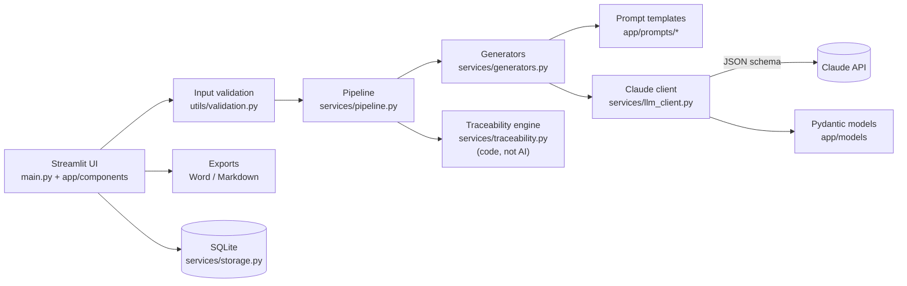

# AI Business Requirements Analyst

A web application that turns an unstructured business request, such as *"customers keep calling to ask where their order is"*, into a complete, **traceable** set of business-analysis deliverables. It behaves like a careful Business Analyst: it asks clarifying questions first, labels every assumption, refuses to guess when a request is too vague, and verifies its own output.

Built with Python, Streamlit, SQLite, pandas and the Claude API.

> **Try it without an API key:** open the app and choose *View pre-generated analysis* on the order-tracking, sales-leads or vague-request example.

---

## The business problem

Requirements gathering is where many IT projects go wrong. A stakeholder describes a need in a sentence or two. Turning that into requirements, user stories, acceptance criteria and test cases takes an analyst days, and the result often has gaps:

- **Unstated assumptions** get treated as agreed facts.
- **Conflicting stakeholder demands** go unnoticed until development.
- **Requirements lose their link to the business need.** Nobody can say which test proves which objective was met.

Generic AI chatbots make this worse. They produce confident, well-formatted documents full of invented details.

## Project objectives

1. Produce the standard BA deliverables from a plain-language request in minutes.
2. **Never invent facts.** Separate what the stakeholder said from what was inferred or assumed.
3. **Ask before writing.** Put clarifying questions in front of the user and stop when a request is too vague.
4. **Guarantee traceability** from business objective to test case, checked by code rather than trusted from the AI.
5. Keep the architecture simple enough to explain end to end in an interview.

## Features

| Area | What it does |
|---|---|
| **Clarifying questions** | Groups questions into Critical / Important / Nice to Know, and every Critical question explains why it matters. You can answer them, and the analysis is re-run with your answers, or proceed with documented assumptions. |
| **"Too vague" gate** | If the request lacks the basics (who, what problem, what outcome), the app lists the missing information and blocks requirements generation. |
| **Conflict detection** | Flags contradictory demands. In the sales example, *"auto-assign every lead within five minutes"* versus *"the director approves every lead first"*. |
| **Business problem analysis** | Problem statement, objectives (BO-01…), target users, current and future state, scope, ambiguities. |
| **Stakeholder analysis** | Influence and impact register, engagement grid, and stakeholders the request **didn't mention but probably needs**, such as security or data privacy. |
| **Requirements** | Functional ("The system shall…") and non-functional requirements with MoSCoW priority and rationale, each linked to an objective. "Won't Have" items record scope boundaries. |
| **User stories and acceptance criteria** | INVEST-style stories with Given/When/Then criteria covering positive, negative and edge-case scenarios. |
| **Use cases** | Actor, goal, preconditions, main flow, alternative flows, exceptions and postconditions. |
| **Process analysis** | Current-state and future-state flow diagrams with bottlenecks and manual steps highlighted, plus automation opportunities. |
| **Risks and assumptions** | Risk register sorted by likelihood × impact, an assumptions log saying who should validate each one, constraints and edge cases. |
| **Test cases** | Steps, preconditions, expected results and priority, each linked to requirements and acceptance criteria. |
| **Traceability matrix** | Objective → Requirement → Story → Acceptance Criterion → Test, with coverage metrics and a gap report. |
| **Provenance badges** | Every objective, requirement, stakeholder and constraint is labelled **Stated**, **Inferred** or **Assumed**. |
| **Export and copy** | Word document for review and sign-off, Markdown for Jira, Confluence or GitHub, and a copy button on every section. |
| **History** | Every analysis is saved automatically. A failed or interrupted run can be **resumed** without redoing finished steps. |

## Screenshots

> _Placeholders: add screenshots to `docs/screenshots/` and they will appear here._

| Input and examples | Clarifying questions and conflict detection |
|---|---|
|  |  |

| Traceability matrix | Process analysis |
|---|---|
|  |  |

## Example workflow

1. **Describe the need.** *"Leads from our website and trade shows are tracked in spreadsheets, so they fall through the cracks… The sales team wants every lead auto-assigned within five minutes, but the sales director wants to approve every lead first."*
2. **Review the analyst's understanding** (about 20 seconds). The app restates the problem and lists 5 objectives. It **flags the conflict** and asks about it as the first Critical question.
3. **Answer the questions you can.** *"Auto-assign immediately; the director only reviews strategic accounts (500+ employees), within 4 business hours."* The problem analysis is re-run, and the objectives now reflect the agreed rule.
4. **Generate** (3–6 minutes, with live progress for each stage).
5. **Review the 12 tabs.** For this example: 23 requirements, 10 user stories, 37 acceptance criteria and 62 test cases, with **21 of 21 in-scope requirements fully traced**.
6. **Export to Word** and send it to stakeholders for review.

## Technology stack

| Technology | Role |
|---|---|
| **Python 3.11+** | Application language |
| **Streamlit** | Web interface: tabs, tables, progress and downloads with no front-end build |
| **Claude API** (`anthropic` SDK) | AI analysis with **structured JSON output** |
| **Pydantic** | Schemas for every artifact, plus business-rule validation of AI output |
| **SQLite** (plain SQL) | Saved analyses and an AI usage audit log |
| **pandas** | Traceability matrix, coverage metrics and tables |
| **Graphviz** (via Streamlit) | Process-flow diagrams generated from structured steps |
| **python-docx** | Word export |
| **pytest** + Streamlit `AppTest` | 144 automated tests, including headless UI tests |

## System architecture



```
main.py                    Streamlit entry point: routes between 3 screens
app/
  config.py                Settings from environment variables (.env)
  models/                  Pydantic schemas: the "data contract" for every artifact
  prompts/                 One prompt template per analysis stage + shared BA rules
  services/
    llm_client.py          Claude API: structured output, validation, corrective retry, errors
    generators.py          One function per stage; batching for long lists
    pipeline.py            Stage order, parallelism, clarification gate, resume
    traceability.py        Matrix + coverage gaps, built deterministically
    storage.py             SQLite repository (plain SQL)
    docx_export.py, markdown_export.py, examples.py
  components/              UI screens and widgets (input, clarification, results, sidebar)
  utils/                   Validation, JSON parsing, errors, diagram and badge helpers
data/examples/             6 business scenarios (3 with pre-generated analyses)
scripts/                   Command-line tools for running analyses and saving demos
tests/                     Unit, integration and headless UI tests (no API calls)
docs/DECISIONS.md          21 architecture and design decisions with reasoning
```

## How the AI component works

The AI is **not** asked to "write a requirements document". The work is split into **10 focused stages**, each with its own prompt and output schema, run in dependency order:

```
Stage 1   Clarifying questions  +  Problem analysis      (parallel)   ──▶ GATE: answer / skip / too vague
Stage 2   Stakeholders  +  Process  +  Risks & assumptions (parallel)
Stage 3   Functional & non-functional requirements       cites objective IDs
Stage 4   User stories  +  Use cases                     (parallel)   cite requirement IDs
Stage 5   Acceptance criteria                            (parallel batches) cite story IDs
Stage 6   Test cases                                     (parallel batches) cite requirement + criterion IDs
          Traceability matrix                            ◀── built by code, not AI
```

Each AI response passes through **three layers of control**:

1. **Structured output.** The request includes a JSON schema generated from the Pydantic model, so the API returns JSON in exactly that shape.
2. **Business-rule validation.** Pydantic enforces the rules a BA would check: IDs in the right format and unique, every Critical question explains why, every story cites a requirement, and **every cited ID exists**. Coverage rules require that every in-scope requirement has a story, every story has acceptance criteria, and every criterion and Must/Should requirement has a test.
3. **Corrective retry.** If validation fails, the exact errors are sent back to the model once, e.g. *"these user stories are not covered: US-007, US-008"*. If it still fails, the user gets a clear message, and the steps that already finished are kept.

**Avoiding invented facts.** A shared system prompt tells every stage to use only the input and direct conclusions from it, to leave unknown values unknown (no made-up targets like "99.9% uptime"), and to label each item **Stated / Inferred / Assumed**. Unanswered Critical and Important questions are passed forward and recorded as assumptions.

**What testing revealed, and how the design responded.** Live runs showed the model sometimes stops long lists early: 1 story for 9 requirements, or criteria for only 2 of 10 stories. The deterministic traceability check caught this. The fixes were coverage rules enforced during validation, and generating criteria and tests in small parallel batches. Details, with before-and-after numbers, are in [docs/DECISIONS.md](docs/DECISIONS.md) (D14, D18).

## Installation

**Requirements:** Python 3.11 or newer.

```bash
git clone <your-repo-url> ai-ba-analyst
cd ai-ba-analyst
python3 -m venv .venv
source .venv/bin/activate
pip install -r requirements.txt
```

Run the app:

```bash
streamlit run main.py
```

It opens at http://localhost:8501. With no API key, the pre-generated examples work, but live analysis is disabled.

> **macOS + iCloud note:** if the project folder syncs to iCloud (e.g. on the Desktop), create the virtual environment *outside* it, for example `python3 -m venv ~/.venvs/ai-ba-analyst`. iCloud can offload library files, which makes imports hang.

## Environment variables

Copy the template and add your key:

```bash
cp .env.example .env
```

| Variable | Required | Default | Purpose |
|---|---|---|---|
| `ANTHROPIC_API_KEY` | For live analysis | – | Key from [console.anthropic.com](https://console.anthropic.com) |
| `CLAUDE_MODEL` | No | `claude-opus-5` | `claude-sonnet-5` costs about 60% less |
| `MAX_OUTPUT_TOKENS` | No | `16000` | Per-call output limit |
| `DATABASE_PATH` | No | `data/analyses.db` | SQLite file location |

`.env` is git-ignored, and the key is never logged or shown. Users can also paste their own key into the sidebar. It's kept only for that browser session.

**Measured cost** (Sonnet 5): a simple request costs about $0.50, and a 10-story project about $0.70–0.90. Opus 5 costs roughly 2.5× as much.

## Testing

```bash
python -m pytest
```

144 tests run in about 7 seconds and **make no API calls**. A fake AI client and a stubbed SDK simulate responses, including malformed JSON, refusals, truncation, rate limits and outages.

| Area | Examples |
|---|---|
| Input validation | Empty, too short, too long (6,000-character limit), vague-request warnings, whitespace normalization |
| JSON parsing | JSON in Markdown fences, JSON surrounded by prose, invalid JSON, unexpected shapes, extra fields |
| Models and formatting | User-story sentence format, Given/When/Then, MoSCoW variants such as `"must have"` or `"MUST_HAVE"`, ID formats |
| AI client | Corrective retry, refusal and truncation handling, 7 API error types mapped to friendly messages, missing key |
| Pipeline | Stage order, context passed forward, clarification gate, resume after failure, invalid references, coverage rules, batching |
| Traceability | Fully traced chains, each kind of gap, Won't Have scope, broken references |
| Storage | Round trip, update, delete cascade, SQL aggregates, **SQL-injection attempt**, status constraint |
| Exports | Every Markdown section, Word headings and tables, diagram generation and escaping |
| UI (headless) | Page loads, examples, demo analyses, full journey request → clarify → results, answers reach the AI, vague gate |

Realistic sample data lives in `tests/conftest.py`: an internally consistent order-tracking analysis with every artifact linked.

To run a live analysis from the command line (uses API credits):

```bash
python -m scripts.run_analysis --example 02_it_equipment
```

## Limitations

- **AI output is a draft, not a sign-off.** It must be reviewed with stakeholders. The provenance badges and assumptions log show where to focus.
- **Latency:** a full analysis takes 3–6 minutes (about 10–25 API calls). Keep the browser tab open while it runs.
- **Cost:** about $0.50–0.90 per analysis on Sonnet 5, and more on Opus 5.
- **Single user:** there are no accounts. History is shared by anyone using the same app instance.
- **The Word export has no process diagrams.** They appear as tables, because rendering diagrams to images needs the Graphviz system binary.
- **English only**, and the output format is tuned for software and IT process requests.

## Future improvements

- Edit and approve individual requirements in the app, with a change log.
- Export stories and acceptance criteria straight to Jira or Azure DevOps.
- Lower reasoning effort for simpler stages, and prompt caching of the shared context, to cut cost and time.
- An evaluation set of reference requests with expected findings, to measure prompt changes objectively.
- Process diagrams in the Word export, and a PDF export.
- User accounts with per-user history, then deployment to Streamlit Community Cloud.

## Architecture & Design Decisions

The full reasoning for each decision, including what was measured, is in **[docs/DECISIONS.md](docs/DECISIONS.md)**. The key ones:

| Decision | Why |
|---|---|
| **Staged pipeline, not one big prompt** (D1) | Mirrors how a BA works. Each stage is focused, testable and retryable, and later stages cite earlier IDs, which makes traceability possible. |
| **Data contract before AI** (D2) | Pydantic models define what a *valid* requirement or story is, and the AI's output must meet that definition. |
| **Stated / Inferred / Assumed on every item** (D3) | The main defence against confident but invented detail. |
| **Traceability built by code** (D15) | Linking is a factual question, so code answers it exactly and independently audits the AI. |
| **Coverage enforced during validation** (D14) | Found and fixed incomplete AI output, with before-and-after measurements. |
| **Small parallel batches for long lists** (D18) | The model stops long lists at about 10 items. Smaller batches made coverage reliable and runs faster. |
| **Background jobs that survive page re-runs** (D19) | A real bug found in end-to-end testing: one click could start a duplicate paid run. |
| **Streamlit + SQLite + plain SQL** (D20) | Minimal moving parts. Every layer can be explained, and the SQL is visible and injection-safe. |
| **AI behind an interface, fake client in tests** (D10) | Fast, free, repeatable tests, including failure cases that are hard to trigger for real. |

---

*This project was built with AI-assisted development (Claude Code). The requirements, design decisions, review and testing approach are documented in `docs/DECISIONS.md`.*
